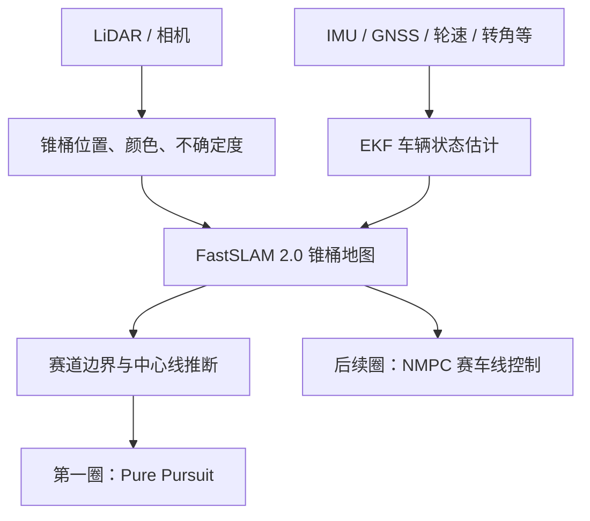

## 感知：给 SLAM 的不是“锥桶点”，而是“带置信度的锥桶观测”

### LiDAR 管线

流程为：

1. 地面去除
2. 欧氏聚类
3. 用几何先验判断 cluster 是否像锥桶
4. 估计锥桶相对车辆的 3D 位置
5. 使用 LiDAR intensity + CNN 估计颜色

LiDAR 的优势是距离精度高、对光照不敏感；论文中特别强调：对锥桶这种矮小目标，LiDAR 的**垂直分辨率**很关键，因为它决定远距离时一个锥桶能被打到多少点。
### 相机管线

- 双目：用于近距离锥桶的稳定深度；
- 单目：用于约 7–15 m 的更远目标；
- YOLOv2 找锥桶；
- 关键点网络 + 2D–3D 对应关系（PnP）估计锥桶姿态与位置。

这点很值得注意：他们没有直接让网络回归 3D 坐标，而是将“检测”和“几何定位”分开。对训练数据有限的学生队伍更稳健。

## 车辆状态估计：先解决“车自己到底怎么动”

论文的一个非常工程化、也很容易被忽略的观点是：

> SLAM 的运动模型好不好，首先取决于车辆速度估计，而不是地图算法名字。

他们使用 **9 状态 EKF**，估计：

\[ x = [v_x,\;v_y,\;r,\;a_x,\;a_y,\; s_{FL},s_{FR},s_{RL},s_{RR}]^T \]

即：

- 纵向速度 \(v_x\)
- 横向速度 \(v_y\)
- 横摆角速度 \(r\)
- 横纵向加速度
- 四个车轮的滑移率

融合的传感器包括 IMU、GNSS/INS、轮速、地速传感器 GSS、转角、电机扭矩等。它不是把轮速直接当车速，而是显式估计轮胎滑移；在极限加速、制动、转弯时，这比普通里程计可信得多
他们还做了两类故障检测：

- **卡方检验**：检测短时毛刺、突发离群值；
- **多传感器方差检测**：检测缓慢漂移或持续故障。

只用卡方检验无法可靠识别慢性漂移，因此两者并用。

## SLAM：为什么选 FastSLAM 2.0，而不是 EKF-SLAM 或扫描匹配

该场景不是典型室内 SLAM：

- 环境非常空旷；
- 没有墙、角点、纹理；
- landmark 基本全是外观相似的锥桶；
- 锥桶的颜色也可能识别错；
- 最大难题是：**这个新观测到底对应地图中的哪一个锥桶？**

因此他们采用 **FastSLAM 2.0**：

- 每个粒子代表一种可能的车辆轨迹 / 数据关联假设；
- 每个粒子内维护自己的 landmark 地图；
- 多假设数据关联可以处理“左右两个锥桶都像同一个”的歧义；
- 粒子数可以调节精度与实时性的平衡；
- 对 landmark 数量是近似线性扩展，而标准 EKF-SLAM 的协方差维护通常是二次复杂度。[arxiv.org](https://arxiv.org/pdf/1905.05150?utm_source=chatgpt.com)

每个锥桶 landmark 不只是位置，而是：

\[ \lambda_i = [\mu_i,\Sigma_i,c_i,n_{seen},n_{missed}] \]

其中：

- \(\mu_i,\Sigma_i\)：锥桶位置均值与协方差；
- \(c_i\)：黄、蓝、橙、未知等颜色估计；
- \(n_{seen}\)：该锥桶被再次观测到的次数；
- \(n_{missed}\)：按理应在视野中却没被看到的次数。

后两个计数器很实用：它们帮助系统发现“地图中的锥桶不可信”或“当前传感器输出异常”，避免错误观测永久污染地图。

## 从锥桶地图到可行驶中线

第一圈地图不完整、颜色可能错、前方看得也不远，所以不能简单“蓝黄锥桶取中点”。

论文方法是：

1. 把已观测的锥桶作为点，进行 **Delaunay triangulation**；
2. 对每条可能跨赛道的边取中点；
3. 在中点图上生成多条候选路径；
4. 通过代价函数选择最像真实赛道中心线的路径；
5. 再反推出左右边界。

代价包含：

- 相邻路径段转角不能突变；
- 赛道宽度方差要小；
- 左右锥桶间距应该近似均匀；
- 颜色概率要与“左蓝右黄”规则一致；
- 路径长度应接近当前传感器可见距离。

颜色错误或无颜色时，并不会让算法失效，只是少了一项约束。[arxiv.org](https://arxiv.org/pdf/1905.05150?utm_source=chatgpt.com)

这与你之前关注的三角剖分中线生成高度一致。你可以把它理解为：

> Delaunay 给出候选拓扑；代价函数负责从“几何上可能”中选出“比赛规则与赛道形态上合理”的路径。

第一圈选择的中线用 Pure Pursuit 跟踪；真正追求圈速的轨迹留给建图完成后的 MPC。