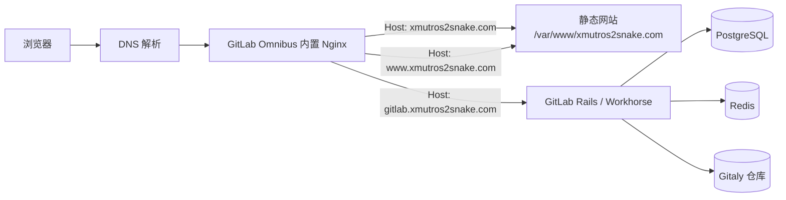

---
tags:
  - 计算机基础
  - 网络
---
| 字段   | 当前值              | 含义                          |
| ---- | ---------------- | --------------------------- |
| 主机记录 | `@`              | 根域名 `xmutros2snake.com`     |
| 主机记录 | `www`            | 子域名 `www.xmutros2snake.com` |
| 记录类型 | `A`              | 将域名指向一个 IPv4 地址             |
| 线路类型 | 默认               | 所有地区用户使用这条解析                |
| 记录值  | `203.195.206.69` | 用户访问域名时要连接的服务器              |
| TTL  | `600`            | DNS 结果缓存约 600 秒             |
## 为什么 A 记录可以填写 IP

DNS 中不同记录类型有不同用途：

- `A`：域名 → IPv4 地址
- `AAAA`：域名 → IPv6 地址
- `CNAME`：域名 → 另一个域名
- `MX`：指定邮件服务器
- `TXT`：保存验证、邮件安全等文本信息

浏览器
  ↓ 查询 DNS
xmutros2snake.com
  ↓ A 记录
203.195.206.69
  ↓ 浏览器连接服务器
Nginx 根据域名选择网站
  ↓
返回 index.html、styles.css、app.js


## 1. 目标与全局架构

此部署将静态项目网站、自建 GitLab 和 GitLab OAuth 登录部署在同一台服务器上：



[[nginx]]
[[静态网站与动态网站]]]


同一公网 IP 可以服务多个域名，是因为浏览器在 HTTP 请求中携带 `Host` 头，而 HTTPS 建连时还会通过 SNI 携带目标域名。Nginx 依据域名选择对应的 `server` 块，不需要为三个域名分别购买服务器。


### DNS、SSL 的区别

|项目|解决的问题|当前状态|
|---|---|---|
|ICP 备案|在中国大陆云服务器提供网站服务的合规要求|已完成|
|DNS 解析|用户访问域名时能找到服务器|已完成|
|SSL/TLS 证书|浏览器与服务器之间的加密与域名身份校验|证书已上传，尚未启用|

[[ssl证书]]


备案不自动提供 HTTPS；HTTPS 也不替代备案。

### 3.3 防火墙与安全组

至少需要允许公网入站：

|端口|协议|用途|
|---|---|---|
|22|TCP|SSH 管理|
|80|TCP|HTTP，以及 HTTP 到 HTTPS 的跳转|
|443|TCP|HTTPS 网站、GitLab 和 OAuth|

云安全组与服务器本机防火墙是两层规则；任意一层阻断 443，外网 HTTPS 都无法访问。若启用了 UFW：

```bash
sudo ufw allow 443/tcp
```


### 4.3 单页应用为什么需要 `try_files`

静态站点使用：

```nginx
try_files $uri $uri/ /index.html;
```

浏览器访问 `/oauth/callback` 时，服务器上没有真实的 `/oauth/callback` 文件。该规则会回退到 `index.html`，再由网页 JavaScript 读取 URL 中的 OAuth 参数。这是单页应用（SPA）客户端路由的常见方式。
[[tryfiles,spa]]